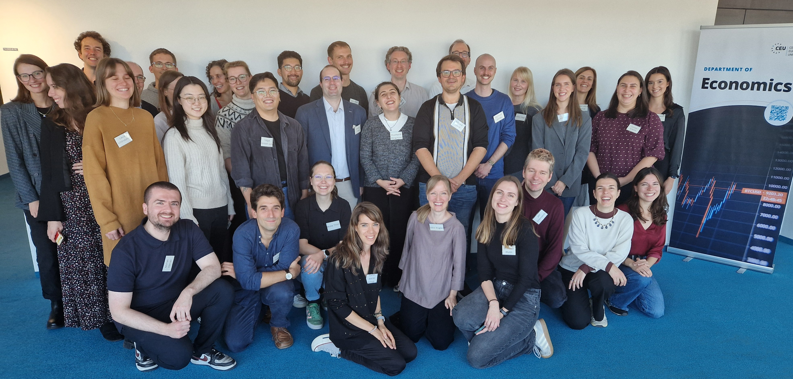
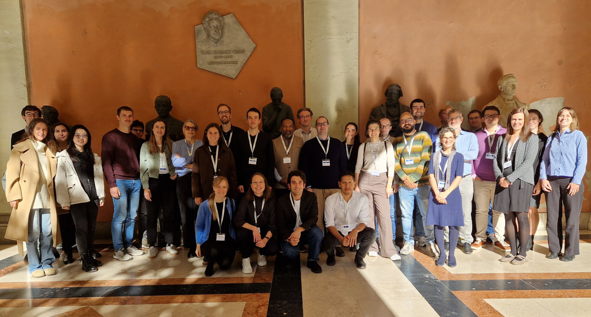
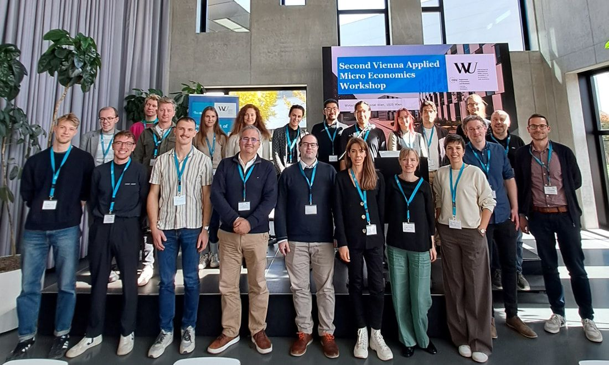
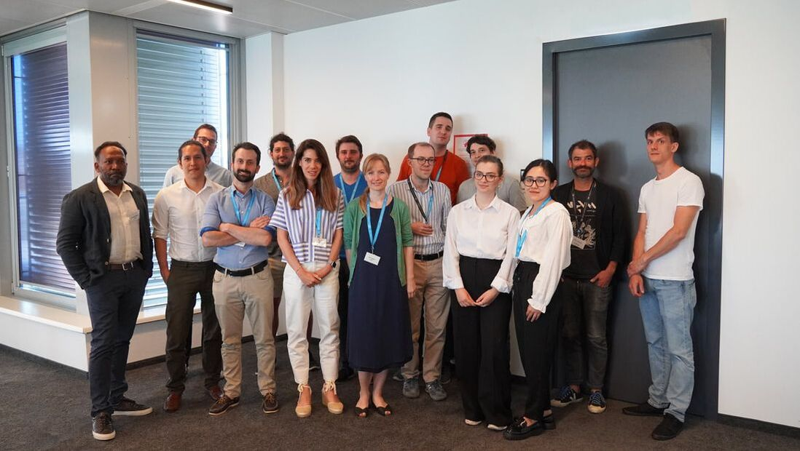

We organise an annual workshop to share recent research on a broad range of Applied Economics topics and to meet with other researchers in Vienna.\
\
Our **fourth annual Vienna Applied Micro Economics Workshop** took place at the Central European University on October 16, 2026.\
[**Program**](assets/4th_VAM_CfP.pdf)\

\
Our **third annual Vienna Applied Micro Economics Workshop** took place at the University of Vienna on October 24, 2025.\
[**Program**](assets/program_vam_workshop_oct_2025.pdf)

\
Our **second Vienna Applied Micro Economics Workshop** took place at the Vienna University of Economics and Business on October 18, 2024. \
[**Program**](assets/programme_vam_2024_20min_presentations.pdf)

\
The **first Vienna Applied Micro Economics Workshop** took place at the Central European University on June 19, 2023.\
[**Program**](assets/programme_vam_2023_final_version.pdf)

